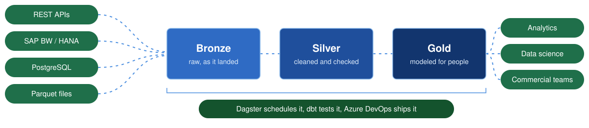

<p align="center"><sub>Monterrey, MX · building AireNL · reading <i>Fluent Python</i> · ES / EN / FR</sub></p>

I build the pipelines that move data from where it's produced to where someone can use it. I got into engineering through economics and public policy, so I care less about the tool of the month and more about whether the numbers at the end can be trusted.

## Lately

- I own 20+ production ELT pipelines at Arca Continental, pulling from REST APIs, SAP, and relational databases into a Snowflake and Delta Lake lakehouse.
- I rewrote a CRM API extraction around pagination and incremental watermarks:

```diff
- full extraction, every run      ~30 min
+ paginated + incremental         ~50 s
```
- I model in Data Vault 2.0 with dbt and PySpark, and orchestrate 50+ assets in Dagster so nothing gets served stale.



## Tools

| | |
|:--|:--|
| **Every day** |           || **Shipped with** | PostgreSQL, Docker, Azure Data Factory, SAP BW/HANA, Pandas, Dask, scikit-learn, XGBoost, R, Tableau |
| **Learning now** | Kafka, Spark Structured Streaming, DuckDB, Airflow |

## On the side

**[AireNL](https://github.com/Arturo14248/aireNL)**  A streaming pipeline for air quality and weather in Nuevo León: Kafka and Spark into an open lakehouse, orchestrated with Airflow, modeled with dbt. Public data that should be easier to read than it is.<!-- TODO: (https://github.com/Arturo14248/aireNL) -->

**Self-hosted LLM.** A distilled open-source model running fully offline through Ollama and Open WebUI, sized to the RAM I had and packed into Docker so it runs the same anywhere.

## Monterrey air

<!-- AIR:START -->
> **PM1 at 25.1 µg/m³** at the Monterrey, Centro station, measured 11 Nov 2026, 23:00 local time. Station data via [OpenAQ](https://openaq.org).
<!-- AIR:END -->

A small scheduled job in this repo fetches that number and rewrites the line, so this page is a (very) small pipeline too. See [`scripts/update_air.py`](scripts/update_air.py).

## Why public data

Before my first pipeline, I studied economics and government. I built a housing-conditions indicator for Mexico from census data and scraped 5,000+ news articles into PostgreSQL to follow how public opinion moved. That's still the work I find most worth doing: taking data that belongs to everyone and making it usable by anyone.

## Off the clock

- World news and markets, usually before the workday starts.
- Music, most of the time I'm working. <!-- TODO: name what you're listening to lately -->
- Reading *Fluent Python*, slowly and properly.
- I tutored math, statistics, and programming through university, and I'd like to teach again.

<details>
<summary>Where I've worked and studied</summary>

<br>

| | | |
|:--|:--|:--|
| 2025 to now | **Arca Continental**, Data Engineer | Lakehouse pipelines, Data Vault modeling, orchestration, data quality |
| 2024 to 2025 | **Chubb**, Data Science Intern | XGBoost and logistic regression models adopted in sales strategy, plus the Dask pipelines feeding them |
| 2023 to 2024 | **Teradata**, Data Engineer Intern | NLP extraction that cut a manual contract review to about 30 seconds |
| 2022 to 2023 | **British American Tobacco**, Trade Insights Intern | Sales analysis and dashboards for regional managers |

**Tecnológico de Monterrey**, 2020 to 2025. B.S. in Economics and B.A. in Government and Public Transformation. 95.19 average, graduated with honors, Academic Talent Scholarship.

**Universidad Complutense de Madrid**, summer 2024. Data science with Python for economics and finance.

</details>

## Say hi

[LinkedIn](https://www.linkedin.com/in/arturo-demian-garcia-nepomuceno) or [arturodemian@gmail.com](mailto:arturodemian@gmail.com). Hablo español, I speak English, et je me débrouille en français.
